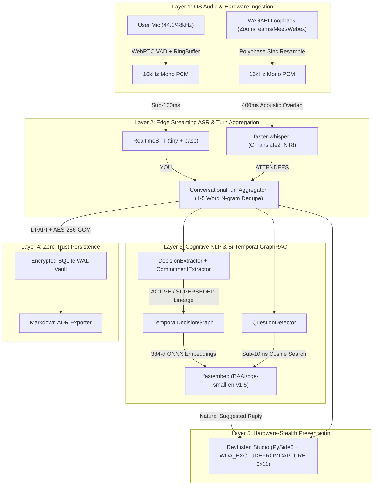

# DevListen — 100% Offline Edge AI Meeting Copilot & Bi-Temporal Knowledge Graph

> **Zero-Cloud. Zero-Latency. Hardware-Stealth.**  
> A privacy-first, developer-focused Edge AI meeting copilot that runs **100% locally** on your machine—combining **Dual-Stream Streaming ASR**, **Bi-Temporal Knowledge Graph (GraphRAG)**, **384-d ONNX Vector RAG**, and **Zero-Trust Encryption** without bots or cloud APIs.

---

### 🌐 Interactive Live Showcase (Works on Mobile & Corporate Laptops)
Try the interactive HUD, **Bi-Temporal Decision Graph**, and **Local Vector RAG** directly in your browser with zero installation:

👉 **[Launch Live Web Demo (`https://devanshu777.github.io/DevListen/`)](https://devanshu777.github.io/DevListen/)**

---

### 🎯 Why DevListen? The Problem We Are Solving

Engineering teams lose critical context every week inside Zoom, Teams, and Webex calls—and existing AI meeting tools fail them in four fundamental ways:

1. **Architectural Amnesia & "Decision Drift":** Teams verbally decide *"Hold off on Redis until Schema v2 lands"*, then two weeks later nobody remembers why or whether an older decision is still valid. **Flat Vector RAG makes this worse** by retrieving both the deprecated decision and the current one.  
   → **DevListen solves this** with a **Bi-Temporal Knowledge Graph** (`ACTIVE` vs `SUPERSEDED` lineage) that surfaces *current* truth and drafts a ready-to-speak response **zero-click** the moment a question is asked.
2. **Enterprise Privacy & NDA Walls:** Streaming confidential architecture reviews, client calls, or security triage to third-party cloud SaaS APIs violates NDA/SOC2/GDPR policies.  
   → **DevListen solves this** by running **100% offline on your CPU** (`faster-whisper` INT8 + `BGE-Small` ONNX + DPAPI/AES-256-GCM encrypted SQLite WAL). Zero bytes ever leave your machine.
3. **Intrusive Meeting Bots & Screen-Share Leaks:** Cloud notetakers drop an awkward *"AI Bot has joined the call"* into meetings, and standard overlays get exposed when you share your screen.  
   → **DevListen solves this** by capturing OS audio passively (`WASAPI Loopback` + `Mic`) with **zero bots in the call**, and using Win32 `WDA_EXCLUDEFROMCAPTURE` so your copilot stays **100% invisible on screen shares**.
4. **Fast-Speech Word Loss in Naive Local STT:** Out-of-the-box local Whisper pipelines hard-chop audio at fixed 2-second intervals and clip rapid syllables with aggressive VAD.  
   → **DevListen solves this** using a **400ms acoustic boundary overlap** + N-gram deduplication pipeline so fast speakers never lose words.

---

### 🏗️ Layered System Architecture (5 Decoupled Layers)



#### Why This Architecture Is Faster, Cleaner & More Efficient:
1. **Dual-Stream Hardware Separation (`YOU` vs `ATTENDEES`):** Capturing your microphone separately from OS loopback audio eliminates acoustic echo/crosstalk and gives deterministic speaker separation for your voice without wasting compute.
2. **400ms Acoustic Boundary Overlap + `vad_filter=False`:** Standard streaming STT pipelines hard-chop audio buffers, slicing syllables in half on fast speakers. Retaining a 400ms trailing overlap and deduplicating 1–5 word seams in `ConversationalTurnAggregator` preserves 100% of boundary words on CPU.
3. **Bi-Temporal Knowledge Graph vs. Flat Vector RAG:** Flat vector databases retrieve outdated decisions alongside current ones, causing contradictions. Tracking `ACTIVE` vs `SUPERSEDED` state lineage ensures RAG always surfaces *current* architectural truth in `<10ms`.
4. **Quantized Edge Inference (`INT8` + `ONNX Runtime`):** Running `faster-whisper` via CTranslate2 INT8 and `BAAI/bge-small-en-v1.5` via ONNX Runtime avoids heavy PyTorch GPU memory footprints—delivering `<190ms` ASR latency and `<10ms` vector search on standard consumer CPUs.
5. **Zero-Trust Local Storage:** Transcripts are encrypted at rest using **Windows DPAPI + AES-256-GCM** inside SQLite WAL mode, while the PySide6 UI uses Win32 `WDA_EXCLUDEFROMCAPTURE` so the copilot stays invisible on screen shares.

---

### 🚀 Current Status, Limitations & Active Roadmap (Contributions Welcome!)

I am building DevListen sincerely in the open and welcome **AI/ML engineers, systems programmers, and contributors** to collaborate:

- **🎙️ Best-in-Class Local STT Baseline:** Our dual-engine local STT pipeline (`faster-whisper` INT8 + `RealtimeSTT` + 400ms overlap) already outperforms most out-of-the-box open-source streaming setups in boundary word retention and CPU responsiveness.
- **🧠 Closing the Gap to DeepSeek Nova2 & Qwen 3.8:** Actively working to bring local suggested-response synthesis closer to **DeepSeek Nova2** quality. Due to current local hardware constraints (CPU/RAM limits), I have not yet been able to benchmark larger frontier open-source local LLMs like **Qwen 3.8**—**contributors with GPU / Apple Silicon setups are warmly invited to help benchmark & integrate quantized `llama.cpp` / GGUF backends!**
- **🗣️ Universal Plugin-Free Speaker Diarization:** Currently engineering app-agnostic acoustic speaker diarization so DevListen identifies remote speakers across **Zoom, Microsoft Teams, Google Meet, Webex, and Discord** directly from system audio—without requiring brittle per-app plugins or intrusive meeting bots.
- **🍎 Cross-Platform Port (Windows → macOS):** Currently **Windows-only** (WASAPI Loopback, DPAPI, Win32 `WDA_EXCLUDEFROMCAPTURE`). **macOS support** (CoreAudio / ScreenCaptureKit, Keychain, `NSWindow` sharing exclusion) is actively planned.

---

### 🛠️ Tech Stack & ML Systems Keywords
`Edge AI` • `Streaming ASR` • `faster-whisper (CTranslate2 INT8)` • `RealtimeSTT (WebRTC + Silero Dual-VAD)` • `Local Vector RAG` • `Bi-Temporal Knowledge Graph (GraphRAG)` • `ONNX Runtime` • `BAAI/bge-small-en-v1.5 (384-d Embeddings)` • `Cosine Similarity Search` • `Asynchronous Producer-Consumer Pipelines` • `DPAPI + AES-256-GCM` • `SQLite WAL` • `PySide6`

---

### 🎥 Run the Voice-Synchronized Demo & Live App

```powershell
# 1. Install dependencies
pip install -r requirements.txt

# 2. Run the neural-voice synchronized demo (great for previewing UI & RAG)
python demo_mode.py

# 3. Run the full live dual-stream desktop copilot (Mic + Loopback + Stealth)
python main.py
```

### 🧪 Verification Suite
```powershell
python test_vault.py
python test_turn_aggregation.py
python test_extractor.py
python test_semantic.py
```
