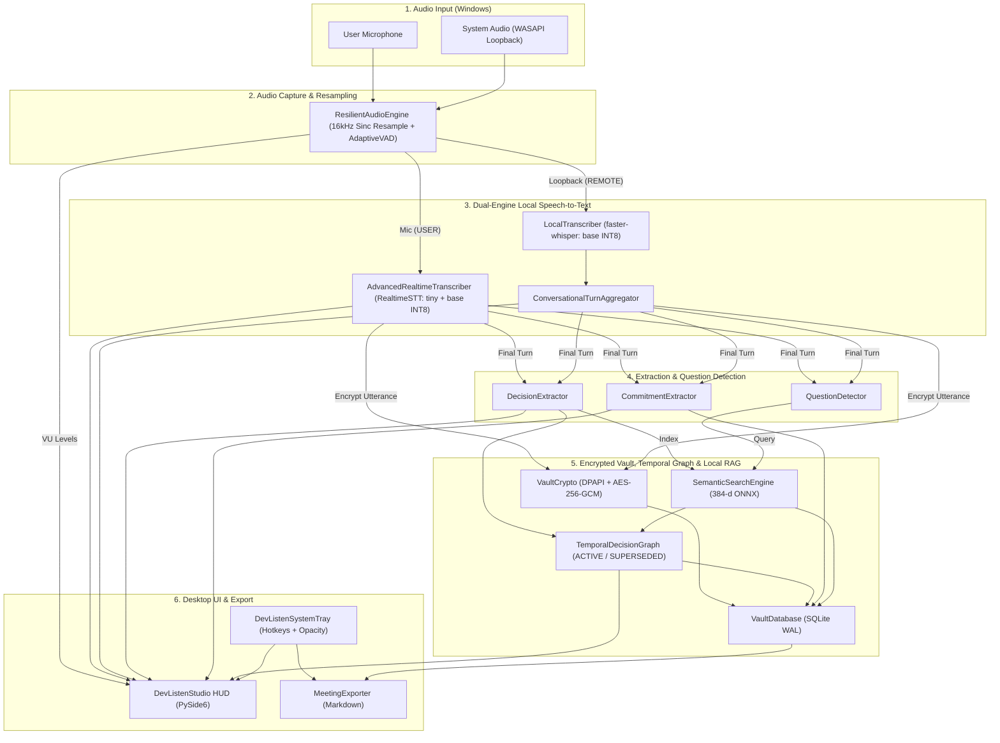

<div align="center">

# 🎙️ DevListen

**Local Edge AI Meeting Copilot & Temporal Decision Memory**

*Dual-stream Windows audio capture, local CPU speech recognition, rule-based decision & action extraction, temporal decision tracking with supersession history, and 384-d ONNX semantic retrieval.*

[](https://devanshu777.github.io/DevListen/)
[](https://www.python.org/)
[](https://github.com/Devanshu777/DevListen)
[](.github/workflows/ci.yml)

[Live Web Demo](https://devanshu777.github.io/DevListen/) • [Architecture](#5-architecture-diagram) • [Installation](#9-installation-and-setup) • [Benchmarks](#13-benchmarks) • [Privacy & Consent](#14-security-and-privacy-considerations)

</div>

---

## 1. Project Introduction

**DevListen** is an offline-first Windows desktop AI meeting assistant built for engineering teams.

During live technical calls (Zoom, Teams, Meet, Webex), important decisions are made verbally and often change weeks later (*"Hold off on Redis until Schema v2 lands"*). DevListen captures both your microphone and system audio locally on CPU, transcribes the conversation, automatically extracts **technical decisions and action items**, tracks **which decisions replaced older ones** (`ACTIVE` vs. `SUPERSEDED`), and surfaces the latest context in a **screen-share-excluded desktop overlay** (`WDA_EXCLUDEFROMCAPTURE`)—with no cloud bots and no external audio uploads.

> 👉 **See it in 30 seconds — [Launch the Interactive Live Demo](https://devanshu777.github.io/DevListen/)**  
> *Click **Start Live Simulation** in your browser to preview the transcription, decision extraction, and temporal memory workflow (static browser simulation using pre-recorded audio; the full local AI pipeline runs in the Windows desktop app `main.py`).*

---

## 2. Problem Statement and Motivation

In engineering syncs, architectural decisions and commitments are often made verbally (*"Hold off on Redis until Schema v2 lands"*). Weeks later, teams lose track of whether an earlier decision is still valid or was replaced.

DevListen addresses three practical issues with typical meeting assistants:
1. **Flat RAG mixes stale and current decisions:** Standard vector search retrieves superseded decisions alongside current ones without modeling chronological state (`ACTIVE` vs. `SUPERSEDED`).
2. **Cloud bots and external uploads:** Sending internal technical discussions to third-party cloud APIs raises NDA and infosec concerns.
3. **Fragmented turn boundaries:** Naive fixed-window transcription clips words mid-thought and mixes microphone audio with remote system audio.

---

## 3. Key Features

<details>
<summary>View feature & test coverage matrix</summary>

| Feature | Verification / Coverage | Implementation |
| :--- | :--- | :--- |
| Conversational turn aggregation & overlap deduplication | **Automated (`pytest` CI)** | `core/turn_aggregator.py` |
| Decision, rejection, migration & commitment extraction | **Automated (`pytest` CI)** | `vault/decision_extractor.py`, `vault/commitment_extractor.py` |
| Temporal decision graph (`ACTIVE` / `SUPERSEDED` / `REJECTED`) | **Automated (`pytest` CI)** | `vault/temporal_graph.py` |
| Encrypted utterance storage (Windows DPAPI + AES-256-GCM) | **Automated (`pytest` CI)** | `vault/crypto.py`, `vault/database.py` |
| Markdown meeting minutes export | **Automated (`pytest` CI)** | `export/meeting_exporter.py` |
| Local 384-d ONNX semantic search (`BAAI/bge-small-en-v1.5`) | **Benchmark / Script Only** | `vault/semantic_search.py` |
| Dual-stream Windows audio capture (Mic + WASAPI Loopback) | **Manual Runtime Only (Not in CI)** | `core/audio_engine.py` |
| Local CPU speech-to-text (`faster-whisper` + `RealtimeSTT`) | **Manual Runtime Only (Not in CI)** | `core/local_transcriber.py`, `core/realtimestt_transcriber.py` |
| PySide6 Desktop HUD with `WDA_EXCLUDEFROMCAPTURE` | **Manual Runtime Only (Not in CI)** | `ui/desktop_studio.py`, `ui/system_tray.py` |
| Multi-speaker remote diarization | **Planned** | — |
| macOS audio & window-exclusion support | **Planned** | — |
| Local LLM response synthesis (`llama.cpp` / GGUF) | **Planned** | — |

</details>

---

## 4. Product Screenshots and Demo

* **Interactive Browser Simulation:** [https://devanshu777.github.io/DevListen/](https://devanshu777.github.io/DevListen/)

### Desktop Application Screenshots (`demo_mode.py` / `main.py`)

**Live Capture & Dual-Stream Transcript**


**Temporal Decisions & Action Items**


**AI Workspace & Local Model Configuration**


**Session Library & Encrypted Vault**


[](https://devanshu777.github.io/DevListen/)

---

## 5. Architecture Diagram

Full source diagram: [`docs/architecture.md`](docs/architecture.md)



---

## 6. Technical Workflow

1. **Audio Capture (`core/audio_engine.py`):** Captures the default microphone and WASAPI speaker loopback streams, resamples both to 16 kHz mono PCM via `scipy.signal.resample_poly`, and gates silence.
2. **Dual-Stream Transcription (`main.py`):**
   * User microphone audio is handled by `AdvancedRealtimeTranscriber` (`RealtimeSTT` with `tiny` interim + `base` final INT8 models on CPU).
   * Remote loopback audio is handled by `LocalTranscriber` (`faster-whisper` `base` INT8 on CPU) and merged into coherent turns by `ConversationalTurnAggregator`.
3. **Extraction & Persistence (`vault/`):** Finalized turns are encrypted with `VaultCrypto` (AES-256-GCM) and stored in SQLite WAL (`utterances`). `DecisionExtractor` and `CommitmentExtractor` parse structured decisions and action items.
4. **Temporal Graph & Semantic Search:** `TemporalDecisionGraph` links superseded decisions (`superseded_by_id`, `superseded_at`). `SemanticSearchEngine` embeds decisions using `BAAI/bge-small-en-v1.5` (`fastembed` ONNX) and ranks queries via normalized dot-product cosine similarity.
5. **Proactive Nudges, Screen-Share Exclusion & Export:** `QuestionDetector` triggers semantic lookup when a question is detected, displaying `CURRENT TRUTH` and `PRIOR HISTORY [SUPERSEDED]` in `DevListenStudio`. On Windows 10/11, the HUD applies Win32 `SetWindowDisplayAffinity(WDA_EXCLUDEFROMCAPTURE)` (`0x11`) so screen-sharing tools (Zoom, Teams, Meet, Webex) exclude the overlay window from captured frames (`demo_mode.py` leaves this off by default unless `--stealth` is passed so walkthroughs can be recorded). `MeetingExporter` exports sessions to Markdown under `~/Documents/DevListen_Exports/`.

### Historical Session Storage (`context_vault.db`)
All session history is persisted locally in a single SQLite database in **WAL (Write-Ahead Logging) mode** (`%LOCALAPPDATA%\DevListen\context_vault.db`) with read-only URI connections for concurrent queries:
* **`meetings`**: Session metadata (`uuid`, `title`, `platform`, `start_time`, `end_time`, `summary_encrypted`).
* **`utterances`**: Raw transcript turns linked by `meeting_uuid`, with speaker label and `text_encrypted` (`12-byte nonce + AES-256-GCM ciphertext/tag` using a DPAPI-protected 256-bit key in `vault.key`).
* **`entities` & `decisions`**: Canonical technical entities and their full decision timeline (`status` in `ACTIVE | SUPERSEDED | REJECTED | PROPOSED`, `effective_from`, `superseded_at`, `superseded_by_id`, plus a 384-d `float32` `embedding` BLOB for local vector search).
* **`action_items`**: Extracted verbal commitments (`assignee`, `task_description`, `completed`, `created_at`) linked to `meeting_uuid`.

---

## 7. Technology Stack

* **Language:** Python 3.10+
* **Desktop UI:** PySide6, Win32 `WDA_EXCLUDEFROMCAPTURE` (`SetWindowDisplayAffinity`)
* **Audio Capture & DSP:** `pyaudiowpatch` (WASAPI Loopback), `numpy`, `scipy`
* **Speech-to-Text:** `faster-whisper` (CTranslate2 INT8), `RealtimeSTT`
* **Local Embeddings / RAG:** `fastembed` (`BAAI/bge-small-en-v1.5`, 384-d ONNX)
* **Persistence & Security:** SQLite (WAL mode), `cryptography` (AES-256-GCM), Windows DPAPI (`crypt32`)
* **Testing & CI:** `pytest`, GitHub Actions (`windows-latest`)

---

## 8. Project Structure

<details>
<summary>View repository structure</summary>

```text
DevListen/
├── main.py                     # Desktop application entrypoint
├── demo_mode.py                # Voice-synchronized desktop simulation runner
├── benchmark.py                # Reproducible subsystem latency benchmark
├── pytest.ini                  # Pytest rootpath and test discovery config
├── requirements.txt            # Runtime dependencies
├── requirements-dev.txt        # Lightweight CI / test dependencies
├── core/
│   ├── audio_engine.py         # Dual-stream WASAPI + mic capture & resampling
│   ├── dev_terms.py            # Technical term normalization rules
│   ├── hardware_profiler.py    # Win32 CPU/RAM/battery/GPU probe
│   ├── local_transcriber.py    # faster-whisper worker & repetition filters
│   ├── question_detector.py    # Rule-based question detection
│   ├── realtimestt_transcriber.py # RealtimeSTT mic wrapper
│   ├── ring_buffer.py          # Audio ring buffer
│   ├── turn_aggregator.py      # Overlap deduplication & turn boundary logic
│   └── vad_detector.py         # Adaptive energy VAD
├── vault/
│   ├── commitment_extractor.py # Action-item & assignee extraction
│   ├── context_formatter.py    # Shared HTML formatter for HUD context cards
│   ├── crypto.py               # Windows DPAPI + AES-256-GCM envelope
│   ├── database.py             # SQLite WAL connection & schema manager
│   ├── decision_extractor.py   # Rule-based decision/rejection/migration parser
│   ├── semantic_search.py      # 384-d ONNX embedding & cosine search
│   └── temporal_graph.py       # Temporal decision history & supersession
├── export/
│   └── meeting_exporter.py     # Markdown meeting minutes exporter
├── ui/
│   ├── desktop_studio.py       # PySide6 Obsidian Glass HUD (active entrypoint)
│   ├── executive_sidecar.py    # Earlier sidecar UI implementation (unused by main.py)
│   └── system_tray.py          # Windows system tray & opacity controls
├── tests/                      # Isolated pytest unit & integration tests
├── test_*.py                   # Legacy standalone verification scripts
├── docs/
│   ├── architecture.md         # Mermaid architecture documentation
│   ├── index.html              # Static browser-based interactive demo
│   └── audio/                  # Pre-recorded demo MP3 clips
└── .github/workflows/ci.yml    # Automated Windows pytest CI
```

</details>

---

## 9. Installation and Setup

**Prerequisites:** Windows 10/11, Python 3.10–3.12, and compatible Windows WASAPI audio output + microphone devices (required for live audio capture in `main.py`).

```powershell
git clone https://github.com/Devanshu777/DevListen.git
cd DevListen

python -m venv .venv
.\.venv\Scripts\Activate.ps1

pip install -r requirements.txt
```

For running tests only (without audio/STT/Qt runtime packages):
```powershell
pip install -r requirements-dev.txt
```

---

## 10. Configuration Requirements

* **No API keys required** for `main.py`.
* **First-run model downloads:** `faster-whisper` (`tiny` ~75 MB, `base` ~145 MB), `RealtimeSTT`, and `fastembed` (`BAAI/bge-small-en-v1.5` ~130 MB) download model weights on first execution if not already cached locally.
* **Local data paths:**
  * Encrypted SQLite database & DPAPI key: `%LOCALAPPDATA%\DevListen\context_vault.db` and `vault.key`
  * Exported Markdown minutes: `~/Documents/DevListen_Exports/`
  * Demo voice cache: `%LOCALAPPDATA%\DevListen\demo_voices\`

---

## 11. Running the Application

* **Full Desktop Copilot (`main.py`):**
  ```powershell
  python main.py
  ```
  Global hotkeys: `Alt+Shift+L` / `Alt+Shift+Space` (Toggle HUD), `Alt+Shift+E` (Export Minutes), `Alt+Shift+Q` (Quit).

* **Voice-Synchronized Desktop Demo (`demo_mode.py`):**
  ```powershell
  python demo_mode.py
  ```
  *(Note: `demo_mode.py` uses `edge-tts` over the network to synthesize demo MP3s on first run, falling back to offline Windows SAPI if unavailable.)*

---

## 12. Testing and Verification

Run the isolated automated test suite (uses temporary databases; does not touch your live vault):

```powershell
pytest -v tests/
```

GitHub Actions automatically runs `pytest -v tests/` on `windows-latest` across Python 3.11 and 3.12 on every push and pull request (see [`.github/workflows/ci.yml`](.github/workflows/ci.yml)).

---

## 13. Benchmarks

Reproducible benchmarks are provided in [`benchmark.py`](benchmark.py) using an isolated temporary SQLite WAL database.

**Test Environment:** Windows 11 (`10.0.26300`), Python `3.12.3`, 12 CPU threads, 15.4 GB RAM, NVIDIA GeForce GTX 1650 Ti (CPU ONNX inference).

| Operation | Iterations | Mean | Median | p95 |
| :--- | :---: | :---: | :---: | :---: |
| `QuestionDetector.is_question` | 500 | 0.47 µs | 0.40 µs | 0.50 µs |
| `VaultCrypto` AES-256-GCM Encrypt+Decrypt | 200 | 8.87 µs | 7.90 µs | 8.40 µs |
| `DecisionExtractor` (+ SQLite write) | 50 | 10.78 ms | 10.60 ms | 13.43 ms |
| `CommitmentExtractor` (+ SQLite write) | 50 | 10.51 ms | 10.30 ms | 12.58 ms |
| `SemanticSearchEngine` (25 docs, 384-d ONNX) | 20 | 6.59 ms | 6.42 ms | 9.31 ms |

*Methodology: `DecisionExtractor` and `CommitmentExtractor` timings include SQLite WAL `INSERT`/`COMMIT` overhead; `VaultCrypto` and `SemanticSearchEngine` are measured after a single warmup (excluding initial DPAPI key unwrap and ONNX model load). End-to-end Whisper ASR latency depends on hardware, chunk size, and model (`tiny` vs. `base`) and is not included in `benchmark.py`.*

Run locally:
```powershell
python benchmark.py
```

---

## 14. Security and Privacy Considerations

* **Local-first storage:** Meeting utterances (`utterances.text_encrypted`) and summaries are encrypted with AES-256-GCM using a 256-bit key protected by Windows DPAPI (`CryptProtectData`).
* **Security model limitations:**
  * DPAPI ties decryption to the current Windows user account—any process running under the same unlocked Windows user session can unwrap `vault.key`.
  * Extracted `decisions.summary`, `entities.name`, and `action_items.task_description` are stored in plaintext SQLite columns to support SQL querying and semantic indexing.
* **Recording Consent & Compliance:** DevListen captures microphone and system audio. Users are solely responsible for obtaining all required participant consent and complying with applicable recording laws and organizational policies before capturing any meeting.

---

## 15. Known Limitations

* **Windows-only:** Relies on `pyaudiowpatch` (WASAPI), Windows DPAPI (`crypt32`), and Win32 `SetWindowDisplayAffinity`.
* **Rule-based extraction:** `DecisionExtractor` and `CommitmentExtractor` use regex patterns, so phrasing outside supported patterns may not be extracted.
* **Manual supersession linking in live extraction:** `TemporalDecisionGraph` supports `supersedes_decision_id`, and `demo_mode.py` demonstrates supersession explicitly, but `DecisionExtractor` does not yet automatically link new decisions to prior active decisions on the same entity during live calls.
* **Single remote stream:** Remote attendees are grouped under `ATTENDEES` without multi-speaker diarization.

---

## 16. Roadmap

* Automatic entity supersession linking in `DecisionExtractor`.
* Acoustic speaker diarization for remote attendees.
* Local LLM response synthesis (`llama.cpp` / GGUF).
* macOS audio capture (`CoreAudio` / `ScreenCaptureKit`) and Keychain integration.

---

## 17. Contribution Guidelines

Contributions, bug reports, and test improvements are welcome. Please:
1. Fork the repository and create a feature branch.
2. Add or update tests in `tests/` for any behavioral changes.
3. Ensure `pytest -v tests/` passes before opening a pull request.
