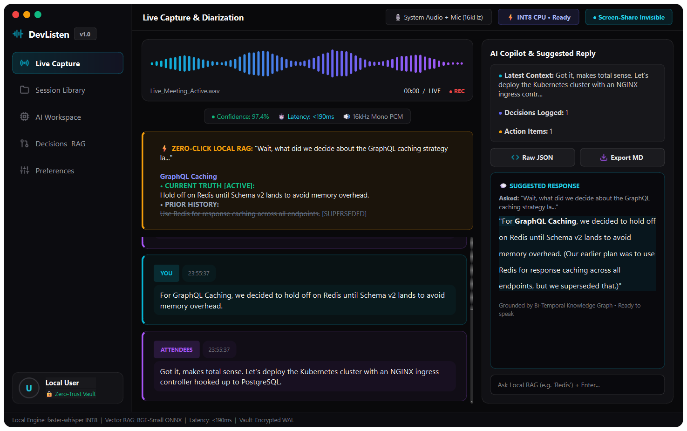
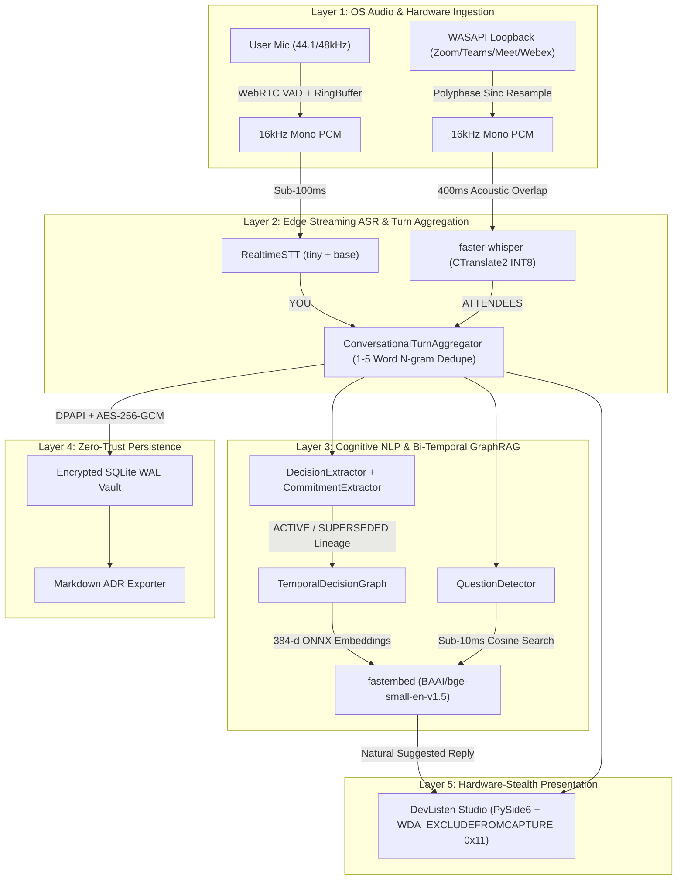

<div align="center">

# 🎙️ DevListen

**100% Offline Edge AI Meeting Copilot & Bi-Temporal Knowledge Graph**

*Zero-Cloud. Zero-Latency. Zero Meeting Bots. Hardware-Invisible on Screen Shares.*

[](https://devanshu777.github.io/DevListen/)
[](https://www.python.org/)
[](https://github.com/Devanshu777/DevListen)
[-6366f1?style=for-the-badge)](https://github.com/Devanshu777/DevListen)

[🌐 Launch Live Interactive Demo](https://devanshu777.github.io/DevListen/) • [📖 Why I Built This](#-why-i-built-devlisten) • [🏗️ Architecture](#️-layered-system-architecture) • [⚡ Quickstart](#-quickstart) • [🤝 Roadmap & Contribute](#-current-status-limitations--roadmap)

</div>

---

## 📖 Why I Built DevListen

In real engineering teams, the most important architectural decisions happen **verbally** inside Zoom, Teams, Meet, or Webex calls (*"Hold off on Redis until Schema v2 lands"*). Two weeks later, someone asks *"Wait, aren't we using Redis?"*—and nobody remembers why the plan changed.

I tried existing AI meeting tools and hit four walls every single time:

1. **Flat Vector RAG retrieves stale truth:** Standard RAG dumps deprecated decisions right next to current ones, causing contradictions.
2. **Cloud bots violate NDA & Infosec rules:** Sending confidential architecture reviews or client calls to external cloud APIs is a non-starter in enterprise teams.
3. **Intrusive bots & awkward screen shares:** Dropping an *"AI Notetaker Bot has joined"* into a call breaks trust, and normal HUDs leak on screen shares.
4. **Naive local STT clips fast speech:** Out-of-the-box local Whisper scripts hard-chop buffers every 2 seconds and drop syllables whenever someone speaks quickly.

So I built **DevListen** from scratch to run **100% locally on CPU**—combining **Dual-Stream Streaming ASR**, a **Bi-Temporal Knowledge Graph**, **384-d ONNX Vector RAG**, and **OS-level screen-share invisibility**.

> **Try it on your phone or corporate laptop right now (no install required):**  
> 👉 **[https://devanshu777.github.io/DevListen/](https://devanshu777.github.io/DevListen/)**
>
> [](https://devanshu777.github.io/DevListen/)

---

## ⚡ How It Works (5-Step Local Pipeline)

| Step | What Happens | Under the Hood |
| :--- | :--- | :--- |
| **1. Capture** | Passively records your mic & meeting audio with **zero bots** | `WASAPI Loopback (48kHz)` + `Mic` → Polyphase Sinc Resample (`16kHz PCM`) |
| **2. Transcribe** | Streams `[YOU]` & `[ATTENDEES]` without clipping fast speakers | `RealtimeSTT` (sub-100ms) + `faster-whisper INT8` (**400ms overlap**, `vad_filter=False`) |
| **3. Understand** | Extracts decisions, action items & detects spoken questions | `DecisionExtractor`, `CommitmentExtractor`, `QuestionDetector`, `TurnAggregator` |
| **4. Remember** | Stores current vs. superseded decisions in `<10ms` RAG | `TemporalDecisionGraph` (`ACTIVE`/`SUPERSEDED`) + `BAAI/bge-small-en-v1.5` (384-d ONNX) |
| **5. Assist** | Drafts a natural spoken reply on a **screen-share invisible** HUD | `DevListen Studio` (`PySide6` + `WDA_EXCLUDEFROMCAPTURE 0x11`) + `DPAPI/AES-256-GCM` |

---

## 🏗️ Layered System Architecture



### Why This Architecture Is Efficient
- **Dual-Stream Isolation (`YOU` vs `ATTENDEES`):** Separating mic from OS loopback at the driver level eliminates acoustic echo and self-diarization errors.
- **400ms Acoustic Overlap + `vad_filter=False`:** Prevents mid-word syllable slicing on rapid speakers while `ConversationalTurnAggregator` deduplicates 1–5 word seams cleanly.
- **Bi-Temporal GraphRAG:** Models chronological state decay (`ACTIVE` vs `SUPERSEDED`) so RAG never pollutes answers with deprecated decisions.
- **Quantized Edge Inference:** Runs `CTranslate2 INT8` + `ONNX Runtime` directly on consumer CPUs (`<190ms` ASR latency, `<10ms` vector search, `0` cloud API calls).

---

## 🤝 Current Status, Limitations & Roadmap

I am building DevListen sincerely in the open and welcome **AI/ML engineers, systems programmers, and contributors**:

- **🎙️ Best-in-Class Local STT Baseline:** Our dual-engine local STT pipeline (`faster-whisper` INT8 + `RealtimeSTT` + 400ms overlap) already outperforms most out-of-the-box open-source streaming setups in boundary word retention and CPU responsiveness.
- **🧠 Closing the Gap to DeepSeek Nova2 & Qwen 3.8:** Actively working to bring local suggested-response synthesis closer to **DeepSeek Nova2** quality. Due to current local hardware constraints (CPU/RAM limits), I have not yet been able to benchmark larger frontier open-source LLMs like **Qwen 3.8** locally—**contributors with GPU / Apple Silicon rigs are warmly invited to help benchmark and integrate `llama.cpp` / GGUF backends!**
- **🗣️ Universal Plugin-Free Speaker Diarization:** Currently engineering app-agnostic acoustic speaker diarization so DevListen identifies remote speakers across **Zoom, Microsoft Teams, Google Meet, Webex, and Discord** directly from system audio—without requiring brittle per-app plugins or meeting bots.
- **🍎 Windows Today → macOS Next:** Currently **Windows-only** (WASAPI Loopback, DPAPI, Win32 `WDA_EXCLUDEFROMCAPTURE`). **macOS support** (CoreAudio / ScreenCaptureKit, Keychain, `NSWindow` sharing exclusion) is actively in progress.

---

## ⚡ Quickstart

```powershell
# 1. Clone & install dependencies
git clone https://github.com/Devanshu777/DevListen.git
cd DevListen
pip install -r requirements.txt

# 2. Run the neural-voice synchronized demo (preview UI & RAG flow)
python demo_mode.py

# 3. Run the full live dual-stream desktop copilot (Mic + Loopback + Stealth)
python main.py
```

### 🧪 Verification Suite
```powershell
python test_vault.py
python test_turn_aggregation.py
python test_extractor.py
python test_semantic.py
```

---

<div align="center">

**Keywords:** `Edge AI` • `Streaming ASR` • `CTranslate2 INT8` • `ONNX Runtime` • `Local Vector RAG` • `Bi-Temporal Knowledge Graph (GraphRAG)` • `Dense Embeddings` • `Cosine Similarity Search` • `Dual-VAD` • `Acoustic Boundary Overlap` • `Speaker Diarization` • `Zero-Trust Encryption` • `SQLite WAL` • `PySide6`

</div>
