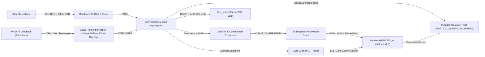

# DevListen — 100% Offline Edge AI Meeting Copilot & Bi-Temporal Knowledge Graph

> **Zero-Cloud. Zero-Latency. Screen-Share Invisible.**  
> A production-grade, privacy-first desktop AI copilot that captures dual-stream meeting audio locally, extracts architectural decisions into a **Bi-Temporal Knowledge Graph**, and surfaces **Zero-Click Local Vector RAG** flashcards in `<10ms`—while remaining completely invisible on Zoom, Teams, and OBS screen shares.

---

### 🌐 Interactive Live Showcase (Works on Mobile & Corporate Laptops)
Recruiters and hiring managers can test the interactive HUD, **Bi-Temporal Decision Graph**, and **Local Vector RAG** directly in their browser without installing anything:

👉 **[Launch Interactive Web Demo (`docs/index.html`)](docs/index.html)** *(Host via GitHub Pages: Settings → Pages → `main` / `/docs`)*

---

### ⚡ Why This Project Exists (Systems & AI Engineering Highlights)

| Capability | Implementation | Performance / Guarantee |
| :--- | :--- | :--- |
| **Dual-Stream Edge ASR** | `RealtimeSTT` (Dual-VAD `tiny` + `base` on Mic) + `faster-whisper` (CTranslate2 INT8 CPU on WASAPI Loopback) | `<190ms` CPU inference, sub-100ms mic streaming |
| **Fast-Speech Continuity** | **400ms acoustic boundary overlap** + N-gram deduplication (`ConversationalTurnAggregator`) | Zero mid-word slicing on rapid speakers |
| **Local Vector RAG** | `BAAI/bge-small-en-v1.5` (384-d ONNX embeddings via `fastembed`) in SQLite | `<10ms` cosine similarity search, 100% offline |
| **Bi-Temporal Knowledge Graph** | `TemporalDecisionGraph` tracking `ACTIVE` vs `SUPERSEDED` decision lineage | Prevents stale architectural context in RAG |
| **Proactive Zero-Click Nudge** | Real-time `QuestionDetector` triggers automatic semantic lookup on spoken questions | Instant teleprompter flashcard without typing |
| **Zero-Trust Encryption** | Windows DPAPI key protection + **AES-256-GCM** encrypted SQLite WAL vault | Confidentiality at rest |
| **OS-Level Stealth HUD** | PySide6 Obsidian Glass Sidecar enforcing Win32 `WDA_EXCLUDEFROMCAPTURE (0x11)` | Hardware-invisible during screen sharing |

---

### 🏗️ System Architecture



---

### 🎥 Running the 1-Click Video Demo & Live App

```powershell
# 1. Run the automated 30-second video recording simulation (OBS-friendly)
python demo_mode.py

# 2. Run the automated simulation WITH hardware screen-share stealth enabled
python demo_mode.py --stealth

# 3. Run the full live dual-stream desktop copilot
python main.py
```

---

### 🧪 Verification Suite

```powershell
python test_turn_aggregation.py
python test_extractor.py
python test_vault.py
python test_semantic.py
```
